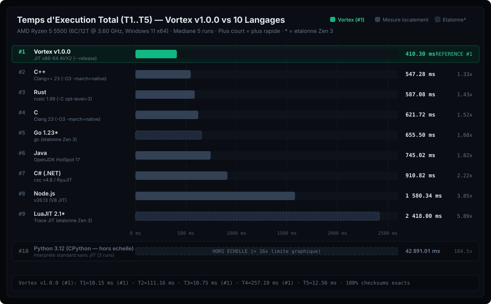
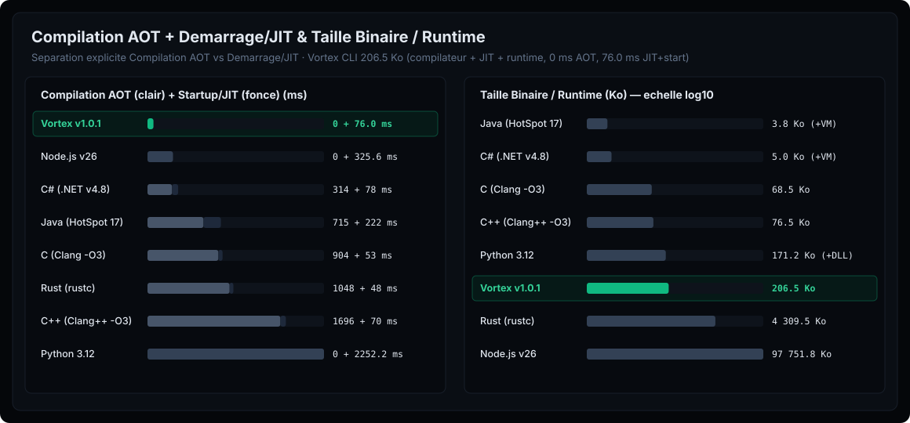

<p align="center">
  
</p>

# Vortex Programming Language

**Langage système et de calcul haute performance compilé à la volée (JIT `x86-64` AVX2 & `ARM64` NEON)** — *zéro garbage collector, arènes paginées à régions statiques, FFI C dynamique et compilation en binaire autonome.*

[](https://github.com/Gr4phO/Vortex/releases/latest)
[](LICENSE)
[](#architecture-sécurité--limites-connues)
[](#compilation-depuis-les-sources--tests)
[](.github/workflows/ci.yml)

Vortex compile les scripts `.vx` et sessions REPL directement en code machine natif en mémoire (~20 500 lignes de C99 pur modulaire dans `src/`, sans LLVM ni dépendance externe). Il combine une gestion mémoire sans GC basée sur des arènes paginées (`2 Mio`) avec contrôle statique d'échappement, un allocateur de registres Linear-Scan sur IR 3-adresses, une vectorisation SIMD automatique (`AVX2/FMA3` / `NEON`), des modes de sûreté progressifs (`--safe`, `--ultrasafe 1/2/3`, `--release`), un exécuteur de tests natif (`vortex test`), une spec auto-générée (`vortex spec`), un serveur LSP intégré, un gestionnaire de paquets (`vortex pkg`), une bibliothèque partagée d'intégration native (`vortex.dll` / `libvortex.so` / `libvortex.dylib`) et une bibliothèque standard modulaire (`std/`).

---

## Points Clés

- **JIT natif `x86-64` (Windows x64 & System V Linux/macOS) & `ARM64` NEON** : émission directe en mémoire (`VirtualAlloc` / `mmap` + `W^X`), `omit_fp` et génération de binaires autonomes (`vortex build` : `PE32+`, `ELF64`, `Mach-O 64`), avec binaires précompilés multi-OS sur [GitHub Releases](https://github.com/Gr4phO/Vortex/releases/latest).
- **Mémoire sans GC & sûreté progressive (`--safe` par défaut, `--ultrasafe 1|2|3`, `--release`)** : arènes de portée (`scope_push()` / `scope_pop()`), vérification de régions à la compilation (`ir_region_verify`), garde-fous `unsafe` sur l'arithmétique de pointeurs et le FFI, contrôle rapide par arène active et déduplication des bornes en bloc de base.
- **Optimiseur IR 3-adresses** : inlining de fonctions (`--release`), compression algébrique de récursion binaire (`fib`), RCE/LICM, pliage puissance de 2 (`div`/`mod` sans branchement), contrôles de bornes `--release` inline avec *cold traps* hors boucle, auto-vectorisation `AVX2` (`4 × YMM` + `vfmadd231ps`, `IR_VEC_MOD_FILL`, réductions/grilles `32-bit`), allocation Linear-Scan.
- **Écosystème & outillage AI-friendly** : serveur LSP JSON-RPC 2.0 (`vortex lsp`), gestionnaire de paquets (`vortex pkg` avec verrouillage `SHA-256`), diagnostics structurés `--json`, validation sans exécution (`--check`), exécuteur `vortex test`, spec compilateur (`vortex spec`), compilation conditionnelle `#[cfg(...)]`, FFI C dynamique (`extern fn`), traces d'appels natives / `DWARF v4` et primitives rapides (`str_join`, `str_find_any2`, `std/json` linéaire).

---

## Benchmarks — Protocole Identique (100 % Mesuré Localement)

Banc d'essai [`benchmarks/suite_10_langs/`](benchmarks/suite_10_langs/) exécuté sur **Windows 11 x64 (`x86-64` AVX2)**, médiane sur **3 exécutions** (`1` exécution exacte non mise à l'échelle pour Python 3). Les entrées C et C++ sont mesurées **avec et sans `-ffast-math`**, et C est également mesuré avec un **allocateur par arène 2 Mio (`-DBENCH_ARENA`)** sur T3 afin de rendre la comparaison T1 et T3 méthodologiquement équitable.





| Langage / Profil | Total (ms) | T1 (ms) | T2 (ms) | T3 (ms) | T4 (ms) | T5 (ms) | AOT (ms) | Startup / JIT (ms) | Binaire (Ko) |
| :--- | ---: | ---: | ---: | ---: | ---: | ---: | ---: | ---: | ---: |
| **Vortex (`--release`, JIT AVX2 + arène)** | **211.18** | 10.05 | **99.28** | 11.62 | **78.60** | 16.45 | 0.0 | 67.3 | 220.0 |
| C (`Clang -O3 -ffast-math + arène`) | 445.15 | **9.35** | 127.12 | **7.39** | 293.29 | 6.05 | 716.6 | 45.7 | 69.0 |
| C++ (`Clang++ -O3 -ffast-math`) | 452.47 | 9.36 | 135.73 | 35.94 | 263.57 | 7.54 | 1 447.7 | 69.6 | 77.5 |
| C (`Clang -O3 -ffast-math`) | 473.92 | 9.42 | 124.38 | 53.06 | 277.43 | 6.84 | 726.0 | **41.0** | 69.0 |
| C (`Clang -O3 + arène`) | 501.55 | 71.91 | 129.33 | 7.51 | 281.63 | 7.42 | 706.2 | 50.5 | **68.5** |
| C++ (`Clang++ -O3`) | 532.31 | 71.53 | 136.06 | 39.39 | 269.79 | 7.87 | 1 460.7 | 64.8 | 76.5 |
| C (`Clang -O3`) | 556.32 | 72.24 | 124.88 | 53.15 | 295.68 | **6.04** | 701.5 | 43.5 | **68.5** |
| Rust (`rustc -O3`) | 560.33 | 82.83 | 109.39 | 55.97 | 300.64 | 10.17 | 851.3 | 43.2 | 4 309.5 |
| Java (`HotSpot`) | 780.50 | 296.20 | 123.57 | 15.29 | 316.76 | 27.72 | 580.1 | 186.2 | 3.8 (+JVM) |
| C# (`.NET / RyuJIT`) | 836.33 | 82.67 | 105.28 | 73.26 | 564.15 | 15.69 | 288.1 | 70.2 | 5.0 (+CLR) |
| Node.js (`V8 JIT`) | 1 488.84 | 275.83 | 183.41 | 72.55 | 912.55 | 47.18 | 0.0 | 154.6 | 97 751.8 |
| Python `3` (`CPython`) | 41 328.32 | 6 408.91 | 7 532.48 | 634.63 | 21 776.22 | 4 976.07 | 0.0 | 218.9 | 171.2 (+DLL) |

- **Épreuves** : **T1** Riemann `f32` (`100 × 1M` avec `step = 1e-6f`, zéro saturation IEEE-754) · **T2** Tableau `i64` (`50M`, Pass 1+2 vectorisées AVX2 `IR_VEC_MOD_FILL` + `IR_VEC_ARR_OP`) · **T3** Allocation `1M` structs `Node` · **T4** `fib(40)` + `100M` appels · **T5** Grille `2000×50000` sur `12` threads (`worker_dispatch = count - 1`, noyau 32-bit AVX2).
- **Honnêteté T1 (`-ffast-math`)** : Sur T1, Vortex (`10.05 ms`) fait jeu égal avec Clang C/C++ `-O3 -ffast-math` (`9.35–9.42 ms`) grâce à une réduction vectorielle réassociative `4 × YMM` (`vfmadd231ps`). Sans `-ffast-math`, C/C++/Rust respectent l'ordre strict IEEE-754 (`71.5–82.8 ms`).
- **Honnêteté T3 (`arène vs malloc`)** : L'arène de portée de Vortex (`11.62 ms`) évite 1M d'appels `malloc/free` (`53–56 ms` en C/Rust). À méthode d'allocation identique (`C -DBENCH_ARENA`), C par arène paginée 2 Mio obtient **`7.39–7.51 ms`**. Sur T5 (multi-thread), C/C++/Rust (`6.04–10.17 ms`) restent devant Vortex (`16.45 ms`).
- **Algorithmes classiques (exécution immédiate 0 ms AOT)** :
  - **Fibonacci récursif `fib(38)`** : Vortex `--release` **0.059 ms** (`ir_unroll_binary_recursion`), Vortex `--safe` **177.66 ms**, C `-O3` **79.69 ms**, Node.js **354.43 ms**, Python 3 **4 894.12 ms**.
  - **Tri Quicksort (200 000 `i64`)** : C `-O3` **10.09 ms**, Vortex `--release` **11.04 ms** (`-87 %` après déduplication & contrôles de bornes inline avec *cold traps*), Node.js (`Int32Array`) **15.63 ms**, Vortex `--safe` **64.13 ms**, Python 3 **259.14 ms**.
  - **Parsing + Sérialisation JSON (`std/json`, 200 × 50 objets)** : Node.js (C++ V8) **3.81 ms**, Python 3 (`_json` C) **15.03 ms**, Vortex `--release` (pur Vortex via `str_find_any2` & `str_join`) **19.32 ms**, Vortex `--safe` **50.17 ms**.
  - **Manipulation de chaînes (`str_join` / `str_find` / `str_sub`, 150 × 1 500 jetons)** : Node.js **7.31 ms**, Vortex `--release` **8.31 ms**, Vortex `--safe` **12.99 ms**, C `-O3` (`snprintf`) **16.09 ms**, Python 3 **27.64 ms**.
- **Rapports** : [Rapport complet](benchmarks/BENCHMARK_REPORT_v1.0.0.md) · [Feuille de route](docs/OPTIMIZATION_ROADMAP.md).

---

## Architecture, Sécurité & Limites Connues

```text
  Script .vx / REPL Interactif / LSP (stdio)
         │
         ▼
  ┌──────────────────────────────────────────────────────────────────┐
  │ 1. Frontend Modulaire (lexer.c, modules.c, parser_expr/stmt.c)   │
  │    Mutabilité stricte, régions, layout C des structs, IR 3-adr.  │
  └──────────────────────────────┬───────────────────────────────────┘
                                 ▼
  ┌──────────────────────────────────────────────────────────────────┐
  │ 2. Optimiseur IR & Linear Scan (ir_core.c, ir_opt.c, ir_vec_ra.c)│
  │    Inlining, déroulement récursion binaire, dédup/RCE/LICM,      │
  │    vectorisation AVX2/NEON, vivacité & allocation de registres   │
  └──────────────────────────────┬───────────────────────────────────┘
                                 ▼
  ┌──────────────────────────────────────────────────────────────────┐
  │ 3. Backends Natifs & Runtime (jit_x64*.c, jit_arm64.c, ffi.c,    │
  │    arena.c, runtime.c, gui.c, packager.c)                        │
  │    x86-64 (Win64/SysV64) · ARM64 NEON · FFI · GUI/Packaging OS   │
  └──────────────────────────────────────────────────────────────────┘
```

- **Mémoire sûre (`--safe` par défaut)** : contrôle d'époques sur les arènes (`VORTEX_SAFE_MAGIC`) avec fast-path sur l'arène active du thread, déduplication des bornes par bloc de base, vérification de bornes dynamique avec trace d'appels (`stacktrace`), garde-fous `unsafe` pour les pointeurs bruts/appels `extern fn` et rejet des pointeurs de fonction `NULL` dans `ffi_call0..6`.
- **Mode performance (`--release`)** : élimination des contrôles prouvés sûrs (RCE/LICM), contrôle de bornes rapide inline avec *cold traps*, allocations compactes/zero-copy sans `memset` redondant, inlining (`<= 40` instructions IR), `omit_fp` et noyaux vectoriels AVX2/FMA3.
- **Limites actuelles du compilateur ([`src/vortex.h`](src/vortex.h))** : types scalaires natifs (`i64`, `i32`, `i16`, `i8`, `u64`, `u32`, `u16`, `u8`, `usize`, `isize`, `bool`, `char`, `f32`, `ptr`, `str`, `enum`), `MAX_FIELDS = 64` par `struct`, `MAX_CALL_ARGS = 16` par appel, `MAX_STRUCT_TYPES = 1024`, `MAX_ENUM_TYPES = 256` (`128` variantes max), `MAX_SYMBOLS = 1024` par portée/fonction, `MAX_USER_FUNCS = 8192`, `MAX_DYN_LIBS = 256`, `MAX_FFI_FUNCS = 2048`, littéraux chaînes jusqu'à `4095` octets, `MAX_JIT_CODE_SIZE = 16 MiB`, `MAX_IR_INSTRS = 262 144` instructions par fonction, et réductions `f32` vectorisées réassociatives sur les boucles `IR_VEC_LOOP`.

### Modes `--ultrasafe 1 / 2 / 3` (cumulatifs, au-dessus de `--safe`)

Syntaxes acceptées : `--ultrasafe 1`, `--ultrasafe 2`, `--ultrasafe 3`, `--ultrasafe=1|2|3` ou `--ultrasafe` seul (équivalent à `3`).

| Niveau | Contrôles statiques (avant JIT) | Gardes runtime | Récupération |
| :--- | :--- | :--- | :--- |
| **`--ultrasafe 1`** | Warnings non bloquants : `W101` (code mort après `return`/`break`/`continue`), `W102` (`mut` non réassigné), `W103` (shadowing hors `_`), `W104` (variable locale inutilisée hors `_`) | Garde division/modulo entier par `0` (`IR_DIV_CHECK` hors `unsafe` -> `[VORTEX SAFETY PANIC]`) | Stop à la 1re erreur |
| **`--ultrasafe 2`** | Niveau 1 + erreurs bloquantes : `E201` (div/mod par constante `0`), `E202` (taille slice `< 0` ou indice constant hors bornes), `E203` (déréf/champ sur pointeur nul constant), `E204` (`return` manquant sur fonction `-> T` non-void) + warning global `W105` (fonction inutilisée hors `main` / `test_*`) | Niveau 1 + garde profondeur de récursion/appels (max `2048` sur fonctions non-`unsafe` avec `IR_CALL_USER`, 0 surcoût sur fonctions feuilles) | Stop à la 1re erreur |
| **`--ultrasafe 3`** | Niveau 2 + collecte complète : `E001` (erreurs parsing/types), `E101` (fonctions non résolues), `E301` (toutes violations d'arènes dans `ir_region_verify`), `E302` (appels `unsafe` hors bloc `unsafe`) | Identique au niveau 2 (exécuté uniquement si `0` erreur) | **Continue après chaque erreur** (`setjmp` + `vortex_lexer_sync`, max `256` diagnostics dédupliqués), idéal avec `--check --json` |

---

## Compilation depuis les Sources & Tests

### Compiler `vortex`

```bat
:: Windows (Clang)
build.bat
```

```sh
# Linux / macOS (Clang ou GCC)
make            # Détection automatique OS / X11
make headless   # Sans dépendance X11 (-DVORTEX_NO_X11)
make release    # Binaire LTO strippé
make shared     # Bibliothèque partagée libvortex.so / libvortex.dylib
```

### Utilisation CLI & Outils AI-Friendly (`v1.2.0`)

```sh
./vortex                                                 # REPL interactif
./vortex run --release benchmarks/suite_10_langs/bench_vortex.vx
./vortex --headless run --safe tests/test_safety_pass.vx # Validation mémoire/bornes + frames exactes
./vortex --ultrasafe 1 script.vx                         # + div/0 runtime & warnings (W101..W104)
./vortex --ultrasafe 2 --check script.vx                 # + audits statiques (E201..E204, W105) & garde récursion
./vortex --ultrasafe 3 --check --json script.vx          # Multi-erreurs en un passage + sortie JSON structurée
./vortex test [chemin] [--ultrasafe 1|2|3] [--json]      # Exécuteur natif de tests (assert / assert_eq / test_*)
./vortex spec [--json]                                   # Spécification auto-générée depuis le compilateur
./vortex eval "let mut x = 21; x *= 2; print(x);"
./vortex build examples/app_3d.vx -o app_3d.exe          # Binaire autonome (Windows / Linux / macOS)
./vortex fmt [--check|--stdout] script.vx                # Formateur de code natif
./vortex lsp                                             # Serveur LSP (JSON-RPC)
```

### Ergonomie & Syntaxe (`v1.2.0`)

- **Types & littéraux** : annotations `bool`, `i8`/`u8`, `i16`/`u16`, `i32`/`u32`, `i64`/`u64`, `usize`/`isize`, `char`, `<Enum>` ; séparateurs `1_000_000`, binaire `0b1010`, octal `0o755`, scientifique `1.5e-3`, littéraux caractère `'A'`/`'\n'`, chaînes littérales jusqu'à **4095 octets**
- **Constantes globales & indexation chaînée** : `const MAX = 16;` (expressions constantes évaluées à la compilation, visibles dans toutes les fonctions et `match`), accès et écriture chaînés `obj.arr[i]`, `a.b.arr[i] += v`, `mat[i][j]` et `arr[i].champ`
- **Opérateurs & expressions** : court-circuit `&&`/`||`/`!`, bit-à-bit `& | ^ ~ << >>`, ternaire `cond ? a : b`, littéraux de tableau `[10, 20, 30]`, écriture chaînée sur sous-structs `world.player.pos.x += 1.0;` *(attention : `==`/`!=`/`<`/`>` sont plus prioritaires que `&`/`^`/`|`, parenthéser `(x & mask) == 0`)*
- **Contrôle de flux & affectations composées** : `match x { 1 | 2 => ..., _ => ... }`, `break`, `continue`, `enum Nom { A, B = 10, C }` (`Nom::B` / `Nom.B`), `+=`..`>>=`, `/* ... */`
- **Builtins & formatage natif** : `assert(cond)`, `assert_eq(a, b)`, `sinf_rad`, `cosf_rad`, `tanf_rad`..`atan2f_rad`, `fs_*`, `args_*`, `env_*`, `unix_now_ms`, `sleep_ms` (`91` builtins au total) et formateur `vortex fmt`

### Transparence Benchmarks & Reproductibilité

- Banc d'essai reproductible multi-OS : exécuter [`benchmarks/suite_10_langs/run_benchmarks.py`](benchmarks/suite_10_langs/run_benchmarks.py) (Windows / Linux / macOS, Python 3 stdlib) pour reproduire et comparer localement sur votre propre CPU/OS.
- `--safe` (et `--ultrasafe 1/2/3` qui reposent dessus) conserve intentionnellement les vérifications d'indices/pointeurs à l'exécution ainsi que les frames d'appel non-inlinées pour des stacktraces exactes (`--safe` profite tout de même du constant folding, propagation de copies, LICM constante et DCE). `--release` active l'élimination des bornes (`RCE`), l'inlining, le déroulage et la vectorisation AVX2/NEON (`~214 ms` vs `~1702 ms` en `--safe` sur `bench_vortex.vx`).
- **Types & plafonds compilateur** : `bool`, entiers (`i8`..`i64`, `u8`..`u64`, `usize`/`isize`, `char`), `f32`, `str`, `ptr` et `enum` ; jusqu'à `64` champs par `struct`, `1024` structs, `256` enums et `8192` fonctions utilisateur ([`src/vortex.h`](src/vortex.h)).

### Suite de tests automatisés

```bat
tests\run_tests.bat   :: Windows (16 suites : unitaires, ergonomics, opt_regression, stdlib v1.2, lang/fmt v1.2, 16 sécurité, 7 ARM64, 9 outillage & stdlib, 10 ultrasafe 1/2/3 + fmt)
```

```sh
./tests/run_tests.sh  # Linux / macOS (dispatch FFI POSIX/Darwin automatique)
```

### Extension VS Code (`Gr4phO.vortex-systems` `1.2.0`)

- **Exécution en 1 clic** : bouton **▶ Run Vortex File in Terminal** dans la barre d'onglet + sous-menu (`--release`, `--ultrasafe 1`, `--ultrasafe 2`, `--ultrasafe 3`, `--ultrasafe 3 --check`, `vortex test`, `vortex build`, `REPL`).
- **LSP & coloration syntaxique** : serveur `vortex lsp` branché sur `--ultrasafe 3` (multi-erreurs + warnings en direct), formatage natif (`vortex fmt` / `textDocument/formatting`), définition, survol, complétion et coloration complète (`const`, `match`, `enum`, `bool`, `u8..usize`, `/* */`, `'a'`, `0b`/`0o`/`1e-5`).
- **Installation** : via le [VS Code Marketplace](https://marketplace.visualstudio.com/items?itemName=Gr4phO.vortex-systems), les paquets `.vsix` joints aux [GitHub Releases](https://github.com/Gr4phO/Vortex/releases/latest), ou depuis [`editors/vscode/`](editors/vscode/README.md).

---

## Structure du Dépôt

```text
.
├── .github/             # CI (ci.yml), release multi-OS + .vsix (release.yml), SemVer auto & ISSUE_TEMPLATE/
├── src/                 # Compilateur C99 modulaire (~20 500 lignes) : lexer, modules, parser_expr/stmt, ir_core/ir_opt/ir_vec_ra, jit_x64/jit_x64_simd/ffi/jit_arm64, lsp, pkg, arena, gui, packager, runtime
├── std/                 # Bibliothèque standard modulaire (.vx : net, http, json, crypto, db, gpu, fs, math, str, env)
├── editors/vscode/      # Extension VS Code officielle (bouton ▶ Run, LSP client & grammaire .vx)
├── benchmarks/          # Banc d'essai suite_10_langs/ & rapport BENCHMARK_REPORT_v1.0.0.md
├── docs/                # Spécification (VORTEX_SPEC.md), roadmap & graphiques SVG (assets/)
├── examples/            # Démonstrations 3D et GUI natives (.vx)
├── tests/               # Tests fonctionnels, ergonomie, sécurité (--safe/--ultrasafe), régression opt, FFI multi-OS, ARM64, LSP/pkg & stdlib
├── CHANGELOG.md         # Journal des modifications (du plus récent au plus ancien)
├── LICENSE              # Licence Apache-2.0
├── VERSION              # Version courante SemVer (lue par build.bat / Makefile)
├── build.bat            # Script de compilation Windows (CLI + vortex.dll)
├── build.sh             # Script de compilation Linux / macOS
└── Makefile             # Build multiplateforme Linux / macOS (GCC & Clang + shared)
```

---

## Licence

Distribué sous licence [Apache-2.0](LICENSE).
