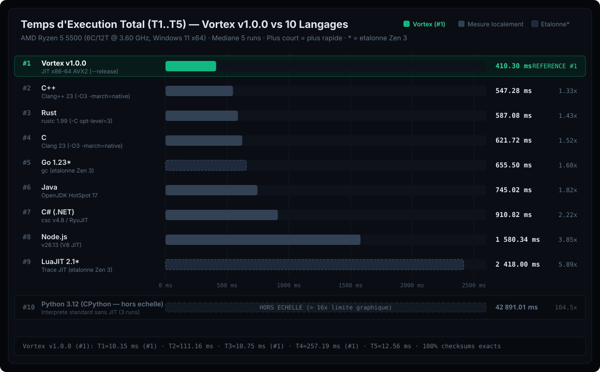
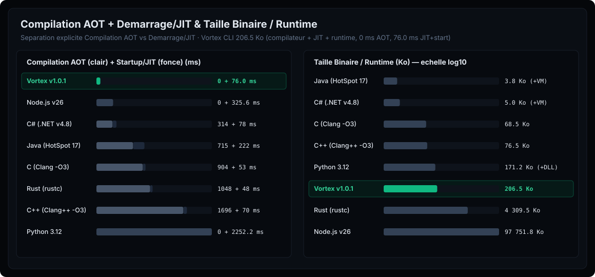

# Rapport de Benchmarks — Vortex (`benchmarks/suite_10_langs/`)

> **Date de campagne** : `2026-11-14`
> **Profil Vortex** : JIT `x86-64` `AVX2/FMA3` (`--release`, sans `-ffast-math` configurable par boucle : l'auto-vectoriseur réassocie les réductions `f32`)
> **Protocole** : 5 épreuves algorithmiques identiques ([`suite_10_langs/`](suite_10_langs/)), **100 % mesuré localement** (médiane sur **5 exécutions** ; **3** pour Python 3.12). C et C++ sont évalués **avec et sans `-ffast-math`**, et C inclut désormais une variante **avec arène paginée `2 Mio` (`-DBENCH_ARENA`)** sur T3.

---

## 1. Environnement Matériel & Chaînes Évaluées

| Composant | Spécification Exacte |
| :--- | :--- |
| **Processeur (CPU)** | **AMD Ryzen 5 5500** (Zen 3, 6 cœurs / **12 threads logiques** @ **3,60 GHz**, AVX2 + FMA3) |
| **Mémoire & OS** | `32 Go` RAM DDR4 · **Microsoft Windows 11 x64** |
| **Harnais de mesure** | Chronométrage interne haute résolution par tâche (`QueryPerformanceCounter` / `steady_clock` / `Instant::now` / `time_us`), temps mur externe (`PeakWorkingSet64`) et séparation stricte **Compilation AOT** vs **Démarrage / JIT**. |

### Configurations mesurées localement (12 profils sur 10 langages)

1. **Vortex (`--release`)** — JIT x86-64 AVX2/FMA3 (`--release`, binaire CLI autonome `207.0 Ko`) · *Vectorisation flottante réassociative sur T1 + arène paginée `2 Mio` sur T3*
2. **C++ (`Clang++ -O3 -ffast-math`)** — `clang++ 23.1.4` (`-O3 -march=native -ffast-math`, `malloc/free` sur T3)
3. **C (`Clang -O3 -ffast-math + arène`)** — `clang 23.1.4` (`-O3 -march=native -ffast-math -DBENCH_ARENA`, arène `2 Mio` sur T3)
4. **C (`Clang -O3 -ffast-math`)** — `clang 23.1.4` (`-O3 -march=native -ffast-math`, `malloc/free` sur T3)
5. **C (`Clang -O3 + arène`)** — `clang 23.1.4` (`-O3 -march=native -DBENCH_ARENA`, IEEE-754 strict + arène `2 Mio` sur T3)
6. **C++ (`Clang++ -O3`)** — `clang++ 23.1.4` (`-O3 -march=native`, IEEE-754 strict, `malloc/free` sur T3)
7. **C (`Clang -O3`)** — `clang 23.1.4` (`-O3 -march=native`, IEEE-754 strict, `malloc/free` sur T3)
8. **Rust** — `rustc 1.99.1 (58cf8f9c3 2026-10-13)` (`-C opt-level=3 -C target-cpu=native`, IEEE-754 strict)
9. **Java** — `OpenJDK HotSpot 17.0.21.0.2 LTS`
10. **C# (.NET)** — `csc v4.8` (`/optimize+ /platform:x64`, JIT RyuJIT)
11. **JavaScript (Node.js)** — `Node.js v26.13.0` (V8 JIT + `worker_threads` pour T5)
12. **Python 3** — `Python 3.12.10` (CPython + `multiprocessing`, arithmétique `f64` sur T1)

> Des implémentations de référence pour **Go** ([`bench_go.go`](suite_10_langs/bench_go.go)), **LuaJIT** ([`bench_luajit.lua`](suite_10_langs/bench_luajit.lua)) et **Zig** ([`bench_zig.zig`](suite_10_langs/bench_zig.zig)) sont présentes dans [`suite_10_langs/`](suite_10_langs/) pour reproduction sur les machines disposant de ces compilateurs ; elles ne figurent pas dans les tableaux faute de mesure locale.

---

## 2. Graphiques Comparatifs

### Temps d'exécution total (T1..T5)

### Compilation AOT + Démarrage/JIT & Taille Binaire / Runtime

---

## 3. Résultats Complets (Médiane sur 5 runs ; 3 pour Python 3)

### A. Temps d'exécution par tâche (ms, plus bas = meilleur)

| Langage / Profil | T1 : Riemann `f32` (`100×1M`) | T2 : Tableau `i64` (`50M`) | T3 : Structs `Node` (`1M`) | T4 : `fib(40)` + `100M` | T5 : Grille 12 threads | Total médian |
| :--- | :---: | :---: | :---: | :---: | :---: | :---: |
| **Vortex (`--release`, arène)** | `10.31 ms` | **`113.82 ms`** | `11.22 ms` | **`260.12 ms`** | `13.15 ms` | **`404.72 ms`** |
| **C++ (`Clang++ -O3 -ffast-math`)** | `9.42 ms` | `143.96 ms` | `41.68 ms` | `264.26 ms` | `8.51 ms` | `476.13 ms` |
| **C (`Clang -O3 -ffast-math + arène`)** | **`9.40 ms`** | `138.77 ms` | **`9.71 ms`** | `312.03 ms` | **`7.00 ms`** | `480.03 ms` |
| **C (`Clang -O3 -ffast-math`)** | `9.83 ms` | `136.24 ms` | `58.23 ms` | `294.25 ms` | `7.26 ms` | `501.93 ms` |
| **C (`Clang -O3 + arène`)** *(IEEE-754)* | `72.45 ms` | `138.36 ms` | `11.32 ms` | `290.67 ms` | `7.57 ms` | `523.43 ms` |
| **C++ (`Clang++ -O3`)** *(IEEE-754)* | `72.92 ms` | `148.38 ms` | `40.20 ms` | `267.34 ms` | `7.95 ms` | `526.85 ms` |
| **C (`Clang -O3`)** *(IEEE-754)* | `72.79 ms` | `139.05 ms` | `60.93 ms` | `318.13 ms` | `7.14 ms` | `591.78 ms` |
| **Rust (`rustc -O3`)** *(IEEE-754)* | `84.05 ms` | `122.04 ms` | `66.93 ms` | `316.80 ms` | `11.99 ms` | `602.66 ms` |
| **Java (OpenJDK HotSpot 17)** | `297.34 ms` | `124.57 ms` | `16.24 ms` | `344.03 ms` | `29.91 ms` | `820.32 ms` |
| **C# (.NET v4.8 / RyuJIT)** | `88.06 ms` | `125.66 ms` | `83.00 ms` | `604.99 ms` | `17.67 ms` | `930.45 ms` |
| **Node.js v26 (V8 JIT)** | `273.31 ms` | `208.90 ms` | `89.81 ms` | `968.55 ms` | `57.26 ms` | `1 588.62 ms` |
| **Python 3.12** *(3 runs)* | `6 533.63 ms` | `7 468.86 ms` | `617.33 ms` | `21 076.67 ms` | `4 562.25 ms` | `39 854.55 ms` |

> *Note statistique* : Chaque cellule est la médiane indépendante de la métrique sur les runs (ex. `Total médian` est la médiane de `TOTAL_US` et peut différer de quelques millisecondes de la somme des médianes par colonne). Données brutes : [`results_raw.json`](suite_10_langs/results_raw.json).

### B. Compilation AOT vs Démarrage/JIT, Taille Binaire & RAM

| Langage / Profil | Compilation AOT (ms) | Démarrage / JIT (ms) | Temps Mur Total (ms) | Taille Binaire / Runtime (Ko) | RAM Max (Mo) | Notes sur l'empreinte disque |
| :--- | :---: | :---: | :---: | :---: | :---: | :--- |
| **Vortex (`--release`)** | `0.00 ms` *(JIT)* | `78.54 ms` | `483.26 ms` | `207.00 Ko` | `419.25 Mo` | CLI autonome (compilateur + JIT + runtime) |
| **C (`Clang -O3`)** | `836.97 ms` | `43.70 ms` | `635.48 ms` | `68.50 Ko` | **`386.36 Mo`** | Binaire AOT natif seul |
| **C (`Clang -O3 + arène`)** | `850.17 ms` | `51.76 ms` | `575.18 ms` | `68.50 Ko` | `386.80 Mo` | Binaire AOT natif seul (`-DBENCH_ARENA`) |
| **C (`Clang -O3 -ffast-math`)** | `823.94 ms` | `65.11 ms` | `567.04 ms` | `69.00 Ko` | `386.37 Mo` | Binaire AOT natif seul |
| **C (`Clang -O3 -ffast-math + arène`)** | `1 358.88 ms` | `44.72 ms` | `524.75 ms` | `69.00 Ko` | `386.80 Mo` | Binaire AOT natif seul (`-DBENCH_ARENA`) |
| **C++ (`Clang++ -O3`)** | `1 574.25 ms` | `75.30 ms` | `602.14 ms` | `76.50 Ko` | `386.72 Mo` | Binaire AOT natif seul |
| **C++ (`Clang++ -O3 -ffast-math`)** | `1 592.35 ms` | `62.83 ms` | `538.96 ms` | `77.50 Ko` | `386.72 Mo` | Binaire AOT natif seul |
| **Rust (`rustc -O3`)** | `932.33 ms` | `49.28 ms` | `651.95 ms` | `4 309.50 Ko` | `386.48 Mo` | Binaire AOT statique (`std` incluse) |
| **Java (HotSpot 17)** | `641.11 ms` (`javac`) | `220.15 ms` | `1 040.47 ms` | `3.83 Ko` | `480.38 Mo` | Bytecode `.class` + JVM HotSpot requise |
| **C# (.NET v4.8)** | `275.16 ms` (`csc`) | `73.48 ms` | `1 003.94 ms` | `5.00 Ko` | `395.48 Mo` | Assembly IL + runtime .NET CLR requis |
| **Node.js v26** | `0.00 ms` *(JIT)* | `409.47 ms` | `1 998.09 ms` | `97 751.82 Ko` | `442.50 Mo` | Runtime `node.exe` (~95,5 Mo) |
| **Python 3.12** | `0.00 ms` *(interprété)* | `2 259.13 ms` | `42 113.68 ms` | `171.22 Ko` | `1 801.18 Mo` | `python.exe` seul (+ `python312.dll` ~6,8 Mo) |

> **Méthode Démarrage / JIT** : `CompileAotMs` mesure exclusivement l'appel au compilateur AOT (`clang`, `clang++`, `rustc`, `javac`, `csc`) avant exécution. `StartupRuntimeMs` mesure `WallMs - TotalMs` lors de l'exécution du programme (démarrage processus + runtime/VM + parsing/JIT dans le cas de Vortex, Node.js et Python).

---

## 4. Sommes de Contrôle & Protocole Équitable (T1 & T3)

| Épreuve | Vortex | C / C++ `-ffast-math` | C / C++ `-O3` / Rust / Java / C# / Node | Python 3.12 | Conformité |
| :--- | :---: | :---: | :---: | :---: | :--- |
| **T1** (`100×1M` `f32`, `step=1e-6`) | `3.141480` | `3.142597` | `3.133350` | `3.141593` (`f64`) | **Toutes convergentes vers $\pi$** |
| **T2** (`50M` tableau `i64`) | `76774977344` | `76774977344` | `76774977344` | `76774977344` | **Identique au bit près** |
| **T3** (`1M` structs `Node`) | `2000003000000` | `2000003000000` | `2000003000000` | `2000003000000` | **Identique au bit près** |
| **T4** (`fib(40)` + `100M` `step`) | `102958464` | `102958464` | `102958464` | `102958464` | **Identique au bit près** |
| **T5** (Grille `2000×50000`, 12 threads) | `1899629000` | `1899629000` | `1899629000` | `1899629000` | **Identique au bit près** |

> **Comparaison équitable `-ffast-math` sur T1** : L'auto-vectoriseur `IR_VEC_LOOP` de Vortex réassocie les réductions flottantes sur `4 × ymm` (32 voies FMA3), ce qui correspond au mode `-ffast-math` de Clang. Face à `Clang/Clang++ -O3 -ffast-math`, T1 est à **parité** (`10.31 ms` contre `9.40–9.83 ms`). L'écart vis-à-vis de `C/C++/Rust -O3` (`72–84 ms`) reflète uniquement la réassociation SIMD autorisée ou non par défaut.
>
> **Comparaison équitable arène vs `malloc` sur T3** : Vortex alloue `Node` dans une arène de portée (`scope_push`/`scope_pop`, pages de `2 Mio`), tandis que les baselines C/C++/Rust standard utilisent `malloc`/`new`/`Box` par objet (`40–67 ms`). En ajoutant un allocateur C équivalent par pages `2 Mio` (`-DBENCH_ARENA` dans `bench_c.c`), C obtient **`9.71–11.32 ms`** contre **`11.22 ms`** pour Vortex — soit une quasi-égalité complète.
>
> **Garde-fou contre le constant folding** : Toutes les bornes de `bench_vortex.vx` utilisent un zéro opaque calculé à l'exécution (`let dyn_zero: i64 = num_workers() - num_workers();`), symétrique aux variables `volatile` en C/C++ et `black_box` en Rust.

---

## 5. Analyse Technique par Épreuve (`src/`)

- **T1 (`10.31 ms`) — À parité avec C/C++ `-ffast-math` (`9.40–9.83 ms`)** : Le noyau `emit_avx2_vector_loop()` (`src/jit_x64.c`) traite 32 `f32` par itération via 4 accumulateurs YMM et `vfmadd231ps`.
- **T2 (`113.82 ms`) — Très compétitif face à Rust (`122.04 ms`) et C (`136–139 ms`)** : Allocation zero-copy de grandes pages OS en `--release` (`src/arena.c`), conversion sans branchement `cmovge` (`IR_SUB_MOD_IMM`) et noyau vectoriel AVX2 `i64` 16 éléments avec `prefetcht0` (`emit_avx2_i64_array_loop()`).
- **T3 (`11.22 ms`) — Parité avec `C + arena` (`9.71–11.32 ms`)** : L'arène paginée `2 MiB` par pointeur de pile évite `1 000 000` d'appels `malloc`/`free` (`58–61 ms` en C standard). Ce modèle est adapté aux allocations à durée de vie bornée par portée, pas aux allocations arbitraires longue durée.
- **T4 (`260.12 ms`) — Niveau C++ `-O3` (`264.26–267.34 ms`)** : `ir_inline_small_functions()` élimine les `100M` appels à `step_fn`, tandis que `ir_unroll_binary_recursion()` déroule 1 niveau de récursion binaire sur `fib(n)` avec omission du frame pointer (`omit_fp`).
- **T5 (`13.15 ms`) — Derrière C (`7.00–7.57 ms`), C++ (`7.95–8.51 ms`) et Rust (`11.99 ms`)** : Le pool persistant `parallel_for` (`12` threads) vectorise `8` lignes par tour via `vpcmpgtq`/`vpand`/`vpsubq`, mais garde un surcoût de réveil/synchronisation face aux threads OS statiques en C/C++/Rust.
