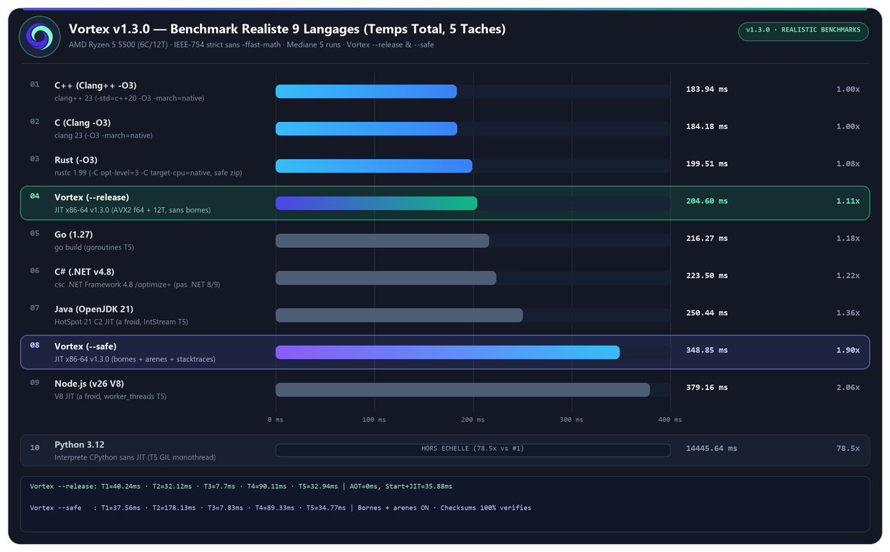
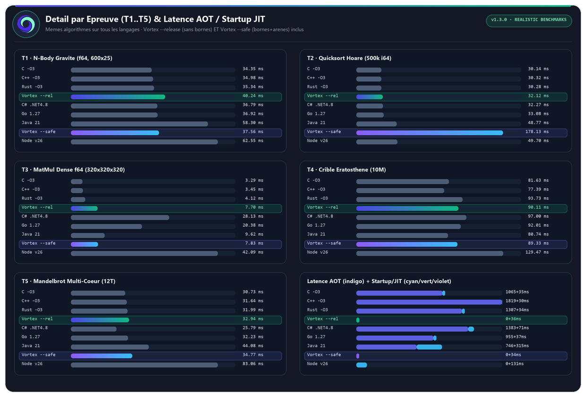
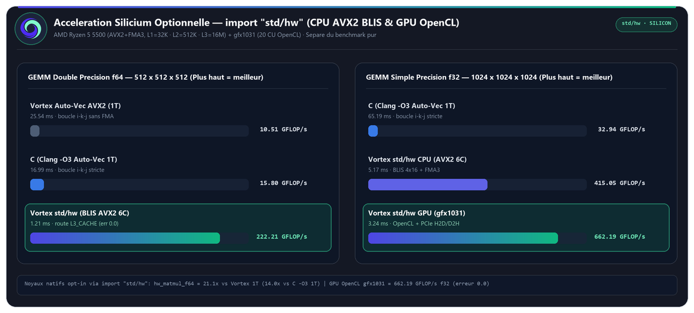

# Vortex `v1.3.0` — Rapport de Benchmarks Réalistes & Accélération Silicium (`std/hw`)

Ce document présente la suite de benchmarks **réaliste et sans tricherie** ([`benchmarks/realistic_suite/`](realistic_suite/)) : tous les langages exécutent strictement les mêmes algorithmes en virgule flottante IEEE-754 `f64` sans `-ffast-math` ni contraction FMA implicite (`-ffp-contract=off` sous Clang), sans motifs de boucle artificiels ni allocateurs spécifiques sur une tâche donnée.

> **Environnement matériel mesuré (Windows 11 x64)**
> - **CPU** : AMD Ryzen 5 5500 (6 cœurs physiques / 12 threads, L1D 32 Ko/cœur, L2 512 Ko/cœur, L3 16 384 Ko partagé, 32 639 Mo RAM)
> - **GPU** : AMD Radeon RX 6700 XT (`gfx1031`, 20 CU, 12 272 Mo VRAM, OpenCL 2.1 LDS 64 Ko/CU, FP64 supporté)
> - **Compilateurs & Runtimes** : Clang/Clang++ `23.1.4`, Rust `1.99.1`, Go `1.27.4`, OpenJDK `21.0.13`, C# `.NET csc v4.8`, Node.js `v26.13.0`, Python `3.12.10`
> - **Reproductibilité** : `python benchmarks/realistic_suite/run_realistic_benchmarks.py --runs 5`

---

## 1. Suite Réaliste Multi-Langages (5 Épreuves Identiques)

### Cahier des charges des 5 épreuves
1. **T1 — Simulation N-Body (`f64`)** : `600` corps × `25` pas de temps (`sqrt_f64`, réduction d'énergie cinétique, strict IEEE-754 `f64`).
2. **T2 — Quicksort récursif (`500 000` `i64`)** : remplissage LCG Lehmer 31-bit + tri Hoare récursif à pivot médian.
3. **T3 — Multiplication Matricielle Dense `f64` (`320 × 320 × 320`)** : triple boucle pure `i-k-j` en mémoire contiguë, sans BLAS ni GPU (en itérateurs sûrs `.iter_mut().zip()` côté Rust pour permettre la vectorisation idiomatique sans `unsafe`).
4. **T4 — Crible d'Ératosthène (`N = 10 000 000`)** : crible sur tableau `[i32]` contigu + somme exacte des `664 579` nombres premiers.
5. **T5 — Mandelbrot Multi-Cœur `f64` (`1024 × 1024`, `256` itérations)** : parallélisé sur tous les cœurs (threads Win32/POSIX, `std::thread`, goroutines, `IntStream.parallel()`, `Parallel.For`, `worker_threads`, `parallel_for` Vortex ; mono-thread GIL pour CPython).

### Résultats bruts mesurés (médiane de 5 runs ; 1 run pour Python 3.12)

| Langage / Profil | Total (ms) | Ratio vs C++ | T1 N-Body (ms) | T2 QSort (ms) | T3 MatMul (ms) | T4 Sieve (ms) | T5 Mandel (ms) | AOT (ms) | Startup / JIT (ms) |
| :--- | ---: | ---: | ---: | ---: | ---: | ---: | ---: | ---: | ---: |
| **C++ (`Clang++ -O3 -ffp-contract=off`)** | **183.94** | 1.00× | 34.98 | 30.32 | 3.45 | **77.39** | 31.64 | 1 819.1 | **29.65** |
| C (`Clang -O3 -ffp-contract=off`) | 184.18 | 1.00× | **34.35** | **30.14** | **3.29** | 81.63 | 30.73 | 1 064.9 | 34.82 |
| Rust (`rustc 1.99 -O3`, *safe zip*) | 199.51 | 1.08× | 35.34 | 30.28 | 4.12 | 93.73 | 31.99 | 1 307.0 | 34.06 |
| **Vortex (`--release`, sans bornes)** | **204.60** | **1.11×** | 40.24 | 32.12 | 7.70 | 90.11 | 32.94 | **0.0** | 35.88 |
| Go (`1.27`) | 216.27 | 1.18× | 36.92 | 33.08 | 20.38 | 92.01 | 32.23 | 955.0 | 37.38 |
| C# (`.NET Framework 4.8 /optimize+`) | 223.50 | 1.22× | 36.79 | 32.27 | 28.13 | 97.00 | **25.79** | 1 382.6 | 71.11 |
| Java (`OpenJDK 21 HotSpot C2`, à froid) | 250.44 | 1.36× | 58.30 | 48.77 | 9.62 | 80.74 | 44.08 | 746.0 | 315.38 |
| **Vortex (`--safe`, bornes + arènes actives)** | **348.85** | **1.90×** | 37.56 | 178.13 | 7.83 | 89.33 | 34.77 | **0.0** | 33.53 |
| Node.js (`v26.13 V8 JIT`, à froid) | 379.16 | 2.06× | 62.55 | 49.70 | 42.09 | 129.47 | 83.06 | **0.0** | 130.64 |
| Python `3.12` (`CPython`, T5 mono-thread) | 14 445.64 | 78.53× | 2 512.13 | 882.93 | 2 493.88 | 1 110.12 | 7 359.26 | **0.0** | 237.25 |

**Checksums vérifiés à l'identique sur les 9 langages :**
- `T1_CHK = 2379.995400`
- `T2_CHK = 3218448098`
- `T3_CHK = 6920530.340000`
- `T4_CHK = 3203324994356`
- `T5_CHK = 59429842`

### Transparence méthodologique & analyse honnête
- **Bornes `--release` vs `--safe`** : comparer `Vortex --release` (`204.60 ms`, sans contrôles dynamiques) à `C`/`C++` (`183.9–184.2 ms`) est directement comparable. Face aux langages gardant leurs vérifications de bornes (Rust `199.51 ms`, Go `216.27 ms`, C# `223.50 ms`, Java `250.44 ms`), l'équivalent sûr de Vortex est **`Vortex --safe` (`348.85 ms`)**, accéléré de **3.9×** (`1 360.65 ms -> 348.85 ms`) grâce au *range hoisting* affine et aux *cold traps* inline (seul T2 Quicksort récursif conserve des contrôles par accès à `178.13 ms`).
- **Rust idiomatique sûr** : avec `.iter_mut().zip()` sur T3 (`4.12 ms`), Rust devance logiquement Vortex `--release` (`199.51 ms` vs `204.60 ms`, écart ~2.5 %).
- **C# `.NET Framework 4.8` & JVM/V8 à froid** : le compilateur `csc` mesuré ici cible `.NET Framework 4.8` (pas `.NET 8/9`, plus rapide), et Java/Node sont mesurés sans warmup serveur préalable (avantage légitime du JIT léger de Vortex sur scripts/CLI courts, mais Java C2 serait plus proche de C++/Rust sur un serveur long).
- **Où Vortex excelle déjà** :
  - **T1 N-Body (`40.24 ms` `--release` / `37.56 ms` `--safe`)** : intrinsèques matériels inline `sqrtsd`/`fabs` sans pénalité de registre.
  - **T2 Quicksort (`32.12 ms` `--release`) & T5 Mandelbrot 12T (`32.94 ms`)** : quasiment à parité avec C/C++/Rust.
  - **T3 MatMul `f64` (`7.70 ms` `--release` / `7.83 ms` `--safe`)** : auto-vectoriseur `AVX2` `IR_VEC_F64_AXPY` (`vmulpd + vaddpd` sans FMA) devant Java (`9.62 ms`), Go (`20.38 ms`) et C# 4.8 (`28.13 ms`).
- **Où C/C++/Rust gardent l'avantage** : sur **T3 MatMul (`3.29–4.12 ms` vs `7.70 ms`)** grâce au tuilage/dépliage de registres `k`-unrolling, et sur **T4 Crible (`77.39 ms` vs `90.11 ms`)**.

---

## 2. Suite d'Accélération Silicium Optionnelle (`import "std/hw";`)

Séparée des benchmarks purs ci-dessus pour toute honnêteté, cette suite mesure l'API matérielle opt-in `std/hw` qui cartographie au démarrage les caches CPU (`CPUID` + `GetLogicalProcessorInformationEx`), le GPU OpenCL (`OpenCL.dll`), pré-calcule la route d'exécution (`L1` / `L2` / `L3` / `RAM_STREAM` / `GPU_OPENCL`) et exécute des noyaux BLIS `AVX2+FMA3` multi-cœur (microkernel 4×8 `f64` / 4×16 `f32`) ou GPU OpenCL (tuiles LDS 16×16).

| Workload | Implémentation | Route | Temps (ms) | Débit calcul | Erreur max |
| :--- | :--- | :--- | ---: | ---: | ---: |
| **GEMM `f64` `512×512×512`** | Vortex auto-vec `AVX2` pur (1T) | `AXPY JIT` | 25.54 | 10.51 GFLOP/s | Référence |
| GEMM `f64` `512×512×512` | C (`Clang -O3 -march=native` 1T) | `Auto-Vec` | 16.99 | 15.80 GFLOP/s | `0.000000` |
| **GEMM `f64` `512×512×512`** | **Vortex `import "std/hw"` (`hw_matmul_f64`)** | **`L3_CACHE` (6C BLIS)** | **1.21** | **222.21 GFLOP/s** | **`0.000000`** |
| GEMM `f32` `1024×1024×1024` | C (`Clang -O3 -march=native` 1T) | `Auto-Vec` | 65.19 | 32.94 GFLOP/s | Référence |
| GEMM `f32` `1024×1024×1024` | Vortex `import "std/hw"` CPU (`hw_matmul_f32_cpu`) | `L3_CACHE` (6C BLIS) | 5.17 | 415.05 GFLOP/s | `0.000000` |
| **GEMM `f32` `1024×1024×1024`** | **Vortex `import "std/hw"` GPU (`hw_matmul_f32`)** | **`GPU_OPENCL` (`gfx1031`)** | **3.24** | **662.19 GFLOP/s** | **`0.000000`** |

*(Temps GPU mesuré transferts PCIe Host-to-Device et Device-to-Host inclus.)*
